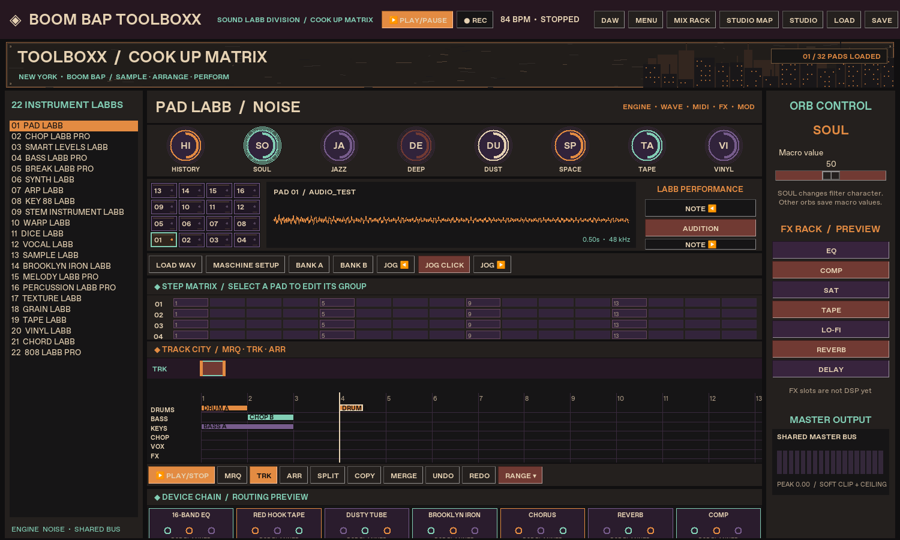

# BOOM BAP TOOLBOXX — Build 066

Native Windows DAW prototype with Cook Up Matrix, 22 LABBs, a 32-slot sample deck, Track City, our sound banks, real master FX, and Native Instruments Maschine Studio control mapping.

## Windows installer

[Download Build 066](https://github.com/pardenself-boop/Pardenself/releases/tag/build-066). Choose **BOOM_BAP_TOOLBOXX_Setup_066.exe**. This single installer includes the app, Python runtime, audio/MIDI libraries and sound-check shortcut. You do not need to install Python or manage source files to run the installed app.

Build 066 is an unsigned development release. Windows 11 audio playback and physical Maschine Studio operation still need testing on the target PC. Native Studio HID, screens/LEDs, a VST build, and FX explicitly marked as previews are not implemented.

## Updates

Open **MENU → CHECK FOR UPDATES…**, check, download, then save your project and choose **INSTALL UPDATE**. Downloads are verified against the release SHA256 before setup can run. Checking and downloading do not stop playback; installation closes the app only after you confirm. Development builds are included. No automatic checks or forced updates run during a session.

## Current UI

## Audio and MIDI setup

Open **MENU → AUDIO + MIDI SETUP…** from Cook Up. Select your output, click START AUDIO, then TEST BASS or TEST KEYS. Scan/select the Studio input and CONNECT. The live log shows note/CC events; COPY TEST REPORT lets you paste the device status and recent events into support chat. The setup window shares the DAW engine and MIDI connection and leaves them running when closed.

## Record sample pads

Select a pattern clip, set a loop covering it, arm REC and start playback. Play your learned pads to overdub sixteenth-note hits with their incoming velocity. Stop recording/playback, then use **MENU → UNDO LAST PAD TAKE / REDO LAST PAD TAKE** if needed. These take commands are separate from arranger undo. Velocity is preserved in playback, project files and WAV bounce. Older projects load; new saves use project v3, which older builds cannot open—keep an original copy if you need to return to them.

## Optional controller count-in

The UI remains unchanged. Use the existing MASCHINE SETUP command selector and MIDI learn to assign **METRONOME TOGGLE** and **COUNT IN TOGGLE** to spare controller buttons. With count-in enabled, arm REC and start playback for four audible lead-in beats before recording. The click is monitor-only and excluded from WAV export. Both preferences are saved with the project.

## Controller workflow

Open **STUDIO MAP** for the editable physical-control diagram and guided sixteen-pad learn. Arrange/Loop/Sound/Browse/FX contexts keep soft keys and encoders in sync with our instruments and chain. The display areas are software mirrors; physical screen output is not implemented. Use **MASCHINE SETUP** to scan/select the Studio's Controller Editor MIDI input, connect, choose a command/mode, and learn a physical control. Use **BANK PAD 1–16** for one physical pad map that follows the DAW bank; **PAD 1–32** remain absolute assignments. Projects save both controller bindings and audio source references.

The installer opens Cook Up directly, adds a desktop shortcut, and includes the runtime. Escape does not close the workspace; editing shortcuts leave text fields alone. MIDI note velocity reaches learned sample pads. In the Studio map, choose **LOOP** for the manual-based position/start/length controls.

The Start Menu **STREET SOUND CHECK (Audio + MIDI)** shortcut opens the test window. Close other MIDI clients if the Windows driver only permits one client at a time.

## Source and build evidence

- [Build 066 details](BUILD_066_README.md)
- [Workflow references and parity gaps](WORKFLOW_REFERENCE_061.md)
- [Controller guide](CONTROLLER_MASCHINE_STUDIO.md)
- [Windows test guide](TEST_AUDIO_MIDI_WINDOWS.md)
- [Windows CI](https://github.com/pardenself-boop/Pardenself/actions/workflows/windows-installer.yml)

The Windows pipeline runs the unit tests, packages the app, checks packaged startup, compiles Setup.exe, checks installation and installed-app startup, then tests uninstallation. The runner is Windows Server 2022, not a physical Windows 11 workstation. Audio/MIDI events used in automated tests are simulated.

Original uploads are preserved under original_uploads/. Earlier build notes are historical. The detailed decorative artwork in the user's visual reference has not been recreated.
